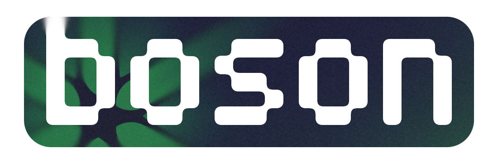

<p align="center">
  
  <br>
  A <b>C3 UEFI bootloader</b> for the x86-64 architecture. Made for the <a href="https://github.com/rickyadastra/muon-kernel/">Muon Kernel</a>.
  <br><br>
  <a href="https://c3-lang.org/"></a>
</p>

Boson loads a ELF kernel binary, prepares its memory and transfers control to it. The project is under active development; interfaces and features might change. 

## Features
- Boots as a UEFI application on x86-64 systems
- Reads 64-bit little-endian a ELF kernel binary
- Loads ELF segments and prepares the kernel page table and stack
- Detects ACPI information and builds a memory map for the kernel
- Transfers control to the kernel through a trampoline

## Getting Started
### Requirements

On Ubuntu 24.04, install [`c3c`](https://c3-lang.org/getting-started/prebuilt-binaries/#installing-on-ubuntu) by following the official guide, and the tools required ro build and run the image using the folllowing command:
```sh
sudo apt install lld mtools qemu-systems-x86 ovmf
```
To run QEMU with KVM acceleration, enable KVM and ensure your user has access to `/dev/kvm`. If you're using WSL2, follow this [KVM setup guide](https://serverfault.com/a/1115773).

### Prepare the Kernel
Boson looks for the kernel at `/EFI/BOOT/muon.sys` in the EFI volume. 
The file must be a little-endian x86-64 ELF64 compatible with the current [specification](#specification). 
The QEMU disk image created by the `make` command **does not** include any kernel binary.

To add or overwrite a kernel binary after creating the image, use the following command:
```sh
mcopy -i build/fat.img <path/to/kernel.bin> ::/EFI/BOOT/muon.sys
```

### Compile and Run
```sh
make        # build bootloader binary, build/boson.efi
make image  # create build/fat.img with the bootloader binary
make run    # create the image and run it in QEMU with OVMF
```
To rebuild all artifacts from scratch, run:
```sh
make clear
```

## Project Structure

| Path | Contents |
| ---- | -------- |
| `src/` | UEFI Application entry point, ELF loading, memory management and trampoline |
| `lib/` | C3 libraries for UEFI definitons and shared functionality |
| `build/` | Build-time folder containing bootloader binary and FAT image |

## Development

Build settings are defined in the [`project.json`](project.json) configuration file.
The [`Makefile`](Makefile) provides targets for creating the image and running it in QEMU.
The default OVMF path is `/usr/share/ovmf/OVMF.fd`.

Boson is an early-stage project developed for the Muon Kernel; it is not currently intended as a general-purpose bootloader for arbitrary kernels.

## Specification

The current specification is a minimal proof-of-concept and **must not** be considered production ready.
The protocol might undergo heavy changes and refactorizations.

Once control is transferred to the kernel, the following are to be expected:
- Each program of the binary is loaded at its specified VMA
- `rip` is the entry point defined in the ELF binary
- `rsp` is `0xFFFFFFFF40003FF8`
- `rbp` is `0xFFFFFFFF40004000`
- `cs`, `ds`, `ss` and other selector registers are left untouched (UEFI defaults)
- The GDT is in an undefined state
- The IDT is in an undefined state; interrupts are disabled
- Paging is active with a PML4 root page; ELF programs, bootloader payload, trampoline, memory regions map and the lowest 2MB of physical memory are mapped; `cr3` contains the physical address of such page table
- `rdi` contains a pointer to a `BootloaderPayload` structure, defined below

### Bootloader Payload Structure
```c3
struct BootloaderPayload {
	uptr pageTablePtr;
	BootloaderKernelStack stack;
	MemoryRegion* memoryRegionMap;
	uint memoryRegionEntries;
	ulong totalMemoryBytes;

	// vendor tables
	uptr rsdpAddr;
}
```

The `rsdpAddr` field is a pointer to the RSDP table. 
See [here](src/modules/boson.c3i) for all the related definitions. 